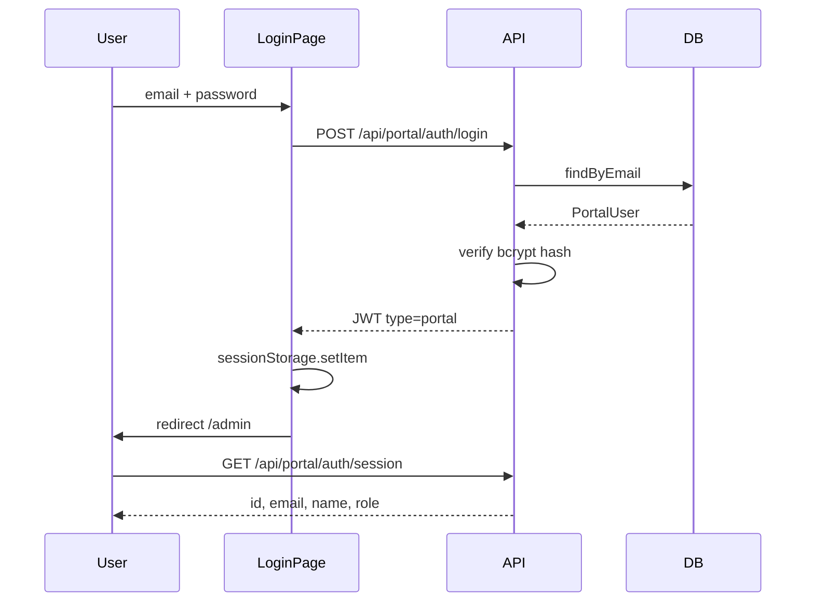

# Hubthink Admin Portal — Auth Design Spec

**Date:** 2026-05-28  
**Status:** Approved  
**Plan:** [2026-05-28-hubthink-admin-portal-auth-plan.md](../plans/2026-05-28-hubthink-admin-portal-auth-plan.md)  
**Scope:** Autenticação do portal interno Hubthink (Fase 1)

---

## 1. Context

O Hubthink Core hoje autentica usuários **Bitrix24** via JWT (`domainId`, `bitrixUserId`) para as apps ThinkZap e ThinkAnalise. Não existe portal interno para operadores Hubthink gerenciarem clientes (`core_domains`) e aplicações (`core_apps`).

### Goals

1. Tabela `portal_users` para operadores com acesso ao portal
2. Login email/senha em `/admin/login`
3. Página inicial protegida em `/admin`
4. JWT separado do fluxo Bitrix (`type: 'portal'`)
5. Contas criadas via script CLI (sem cadastro público)

### Non-Goals

- Página `/cadastro` pública
- Listagem de clientes/apps
- Assinaturas e configurações
- RBAC avançado (apenas role `ADMIN` por ora)
- Cookie httpOnly (fase futura)

---

## 2. Architecture

### 2.1 Backend

Novo módulo `api/src/modules/portal/` seguindo DDD/Hexagonal:

```
portal/
  domain/          → PortalUser entity, repository interface, errors
  application/     → LoginPortalUser, GetPortalSession, password services
  infra/           → Prisma repo, portalAuthMiddleware
  presentation/    → LoginController, SessionController
  main/factories/  → wiring
  routes.ts
```

Rotas montadas em `/api/portal/auth/*`.

### 2.2 Frontend

Route group `(admin)`:

- `/admin/login` — formulário público
- `/admin` — home protegida

Sessão via `sessionStorage` (`hubthink_portal_token`) + `PortalSessionProvider` isolado do fluxo Bitrix.

### 2.3 Auth Flow



---

## 3. Data Model

```prisma
enum PortalUserRole {
  ADMIN
}

model PortalUser {
  id           String         @id @default(uuid())
  email        String         @unique
  name         String
  passwordHash String         @map("password_hash")
  role         PortalUserRole @default(ADMIN)
  isActive     Boolean        @default(true) @map("is_active")
  createdAt    DateTime       @default(now()) @map("created_at")
  updatedAt    DateTime       @updatedAt @map("updated_at")

  @@map("portal_users")
}
```

Sem relação com `Domain` nesta fase.

---

## 4. API Contracts

### POST `/api/portal/auth/login`

**Request:**
```json
{ "email": "admin@hubthink.com", "password": "secret" }
```

**Success (200):**
```json
{ "result": { "token": "eyJ..." } }
```

**Errors:**
- 400 — validação (email inválido, senha vazia)
- 401 — credenciais inválidas (mensagem genérica)
- 403 — usuário inativo

### GET `/api/portal/auth/session`

**Headers:** `Authorization: Bearer <token>`

**Success (200):**
```json
{
  "result": {
    "id": "uuid",
    "email": "admin@hubthink.com",
    "name": "Admin",
    "role": "ADMIN"
  }
}
```

**Errors:**
- 401 — token ausente, inválido, expirado, ou `type !== 'portal'`

### JWT Payload

```typescript
{ type: 'portal', portalUserId: string, role: 'ADMIN' }
```

---

## 5. Security Checklist

- [x] Senhas armazenadas com bcrypt (cost 12)
- [x] Mensagem genérica em credenciais inválidas (não revela se email existe)
- [x] Usuário `isActive: false` rejeitado no login
- [x] Token Bitrix rejeitado pelo `portalAuthMiddleware` (exige `type: 'portal'`)
- [x] Sem endpoint de cadastro público
- [x] Bootstrap via script CLI com env vars opcionais

---

## 6. Frontend UX

- Card centrado com logo Hubthink
- Campos email/senha com labels visíveis
- Toggle show/hide na senha
- Loading no submit, erro inline
- Home: saudação + placeholder + botão Sair
- i18n pt/en/es

---

## 7. Future Phases

- Listagem de `Domain` e `App`
- Assinaturas e configurações
- RBAC com roles adicionais
- Cookie httpOnly + Next.js middleware
- CRUD de usuários portal via UI admin
